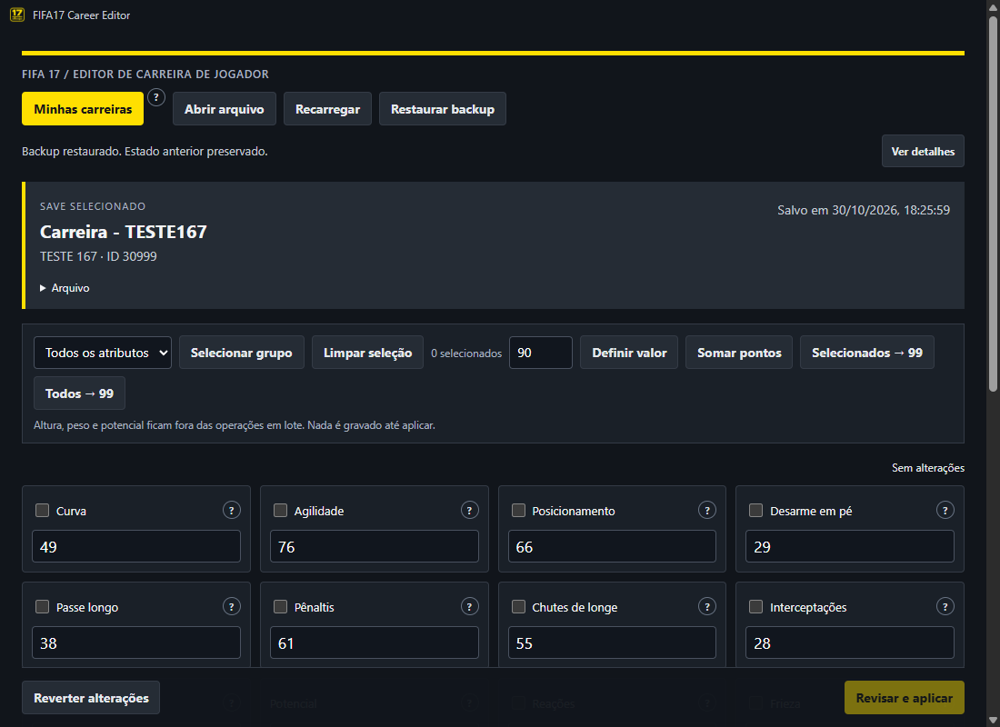

# FIFA 17 Career Editor

[](https://github.com/Habluer/fifa17-save-editor/releases/latest)
[](https://github.com/Habluer/fifa17-save-editor/actions/workflows/ci.yml)
[](LICENSE)


Editor offline do modo **Carreira de Jogador do FIFA 17 para Windows**. Edita atributos, altura e peso do seu jogador, sempre com backup antes de gravar. Não usa Cheat Engine nem altera a instalação do jogo.

> **English:** an offline save editor for FIFA 17 (PC) Player Career mode. It edits your player's attributes, height and weight directly in the save file, with a verified backup before every write. The interface is in Brazilian Portuguese.



## Recursos

- Encontra as carreiras da pasta de saves e mostra o nome e o ID do jogador.
- Edita os 29 atributos, o potencial, a altura e o peso, com explicação de cada atributo.
- Edição em lote por grupo (Físico, Técnica, Defesa…): definir valor, somar pontos ou levar a 99.
- Mostra um resumo das alterações antes de gravar. Nada é salvo sem confirmação.
- Faz backup conferido antes de gravar, recusa o save se o FIFA estiver aberto e permite restaurar qualquer backup.
- Marca o save editado com **EDITADO** no título, para você achar no jogo.

## Usar

1. [Baixe o ZIP em Releases](https://github.com/Habluer/fifa17-save-editor/releases/latest) e extraia tudo para uma pasta gravável.
2. Abra `FIFA17 Career Editor.exe` e escolha a pasta em **Minhas carreiras**, ou use **Abrir arquivo**.
3. Feche o FIFA, edite os valores e confirme em **Revisar e aplicar**.
4. No jogo, procure o save com o título **EDITADO**. Para desfazer, use **Restaurar backup**.

Altura, peso e potencial ficam fora da edição em lote. Guarde cópias independentes das carreiras importantes. A edição de peso tem testes de arquivo, mas a persistência no jogo ainda precisa de confirmação.

As configurações ficam em `data`, ao lado do EXE. Para remover, feche o app e apague a pasta extraída; seus saves e backups continuam na pasta escolhida.

## Como funciona

O save do FIFA 17 é um contêiner `FBCHUNKS` com bancos de dados internos. O editor localiza o jogador da carreira pelo ID, grava os campos bit a bit sem tocar nos vizinhos e recalcula os CRCs de cada banco e tabela. Depois de gravar, ele lê o arquivo de novo para conferir cada valor. O formato está explicado no [mapa do código e guia de adaptação](docs/ADAPTAR.md).

## Desenvolver ou adaptar

Node.js **22.12+**:

```sh
npm ci
npm test
npm run lint
npm start
npm run dist
```

`npm run dist` gera o ZIP em `dist`. Use `npm run format` antes de enviar alterações; a CI confere formatação, lint e testes em cada push e pull request.

Os testes de arquivo e interface usam um save local indicado em `FIFA17_TEST_SAVE`, sempre por cópias temporárias; nunca envie saves pessoais ao repositório. `npm run test:ui` exige essa variável.

O suporte atual é **somente FIFA 17**. O projeto pode servir de base para outros jogos, mas seus formatos e checksums precisam ser investigados: veja o [guia de adaptação](docs/ADAPTAR.md).

## Licença

[MIT](LICENSE). Projeto independente, sem vínculo com a EA Sports. Veja também [Segurança](SECURITY.md).
